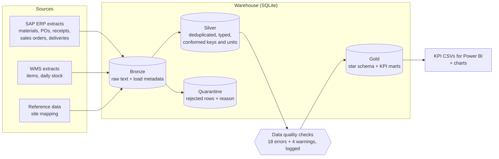
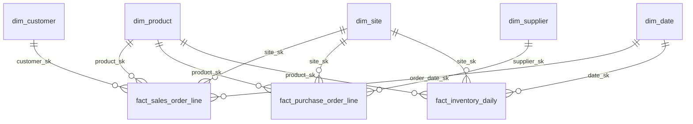
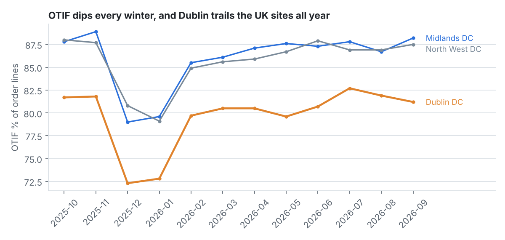
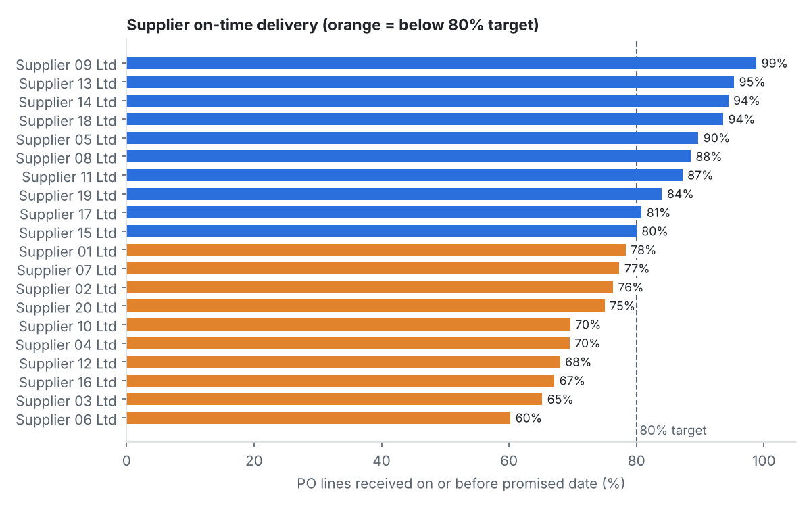

# Supply Chain Data Platform


An end-to-end data engineering project that integrates **SAP-style ERP** and **warehouse management system (WMS)** extracts into a trusted supply chain data model. It cleans and reconciles the data through **bronze / silver / gold** layers, models it as a **Kimball star schema**, runs **automated data quality checks**, and publishes KPIs: **OTIF, fill rate, supplier on-time delivery, days of supply and stockouts**.

> **Note on data:** the source data is synthetic. It comes from a day-by-day inventory simulation (see [`src/generate_data.py`](src/generate_data.py)), so it is safe to share publicly. Real-world integration problems are injected on purpose so the pipeline has to handle them.

---

## The business problem

Supply chain teams need one trusted view of orders, purchasing and stock. In practice that data sits in several systems that don't agree with each other:

| Problem in the source data | Example | How the pipeline handles it |
|---|---|---|
| Different keys for the same product | SAP `MATNR` = `000000000010000123`, WMS `SKU` = `10000123` | Strip leading zeros; build a **material cross-reference** |
| Different site codes | SAP plant `IE10` vs WMS warehouse `DUB` | Business-maintained **reference mapping** table |
| Different units of measure | Dublin WMS reports stock in **cases**, everything else in **eaches** | Convert to eaches using the SAP case size |
| Master data drift | WMS case size disagrees with SAP for 3 products | **Survivorship rule** (SAP is the system of record) + DQ warning |
| Re-extracted rows | ~1% of order lines arrive twice | `ROW_NUMBER()` dedup on the business key, keeping the latest extract |
| Invalid records | Zero quantities, missing or unknown materials, receipts dated before the PO | Routed to **quarantine tables** with a reason code instead of being silently dropped |

## Architecture



| Layer | Purpose | Tables |
|---|---|---|
| **Bronze** | Exact copy of each extract, all columns as text, plus `_source_file` and `_loaded_at`. Never edited, so it acts as the audit trail. | `bronze_*` (10 tables) |
| **Silver** | Deduplicate, validate, cast types, standardise keys and units, quarantine bad rows | `silver_*`, `quarantine_*` |
| **Gold** | Business-ready star schema and KPI marts | `dim_*`, `fact_*`, `kpi_*` |

## Data model (gold)



| Fact table | Grain | Type |
|---|---|---|
| `fact_sales_order_line` | One sales order line | Transaction fact. Carries OTIF flags, days late, delivered value |
| `fact_purchase_order_line` | One PO line | Accumulating snapshot: ordered → promised → received, lead times, days late |
| `fact_inventory_daily` | Product × site × day | Periodic snapshot. Stock is semi-additive (sum across sites, not across days) |

Every dimension has an `Unknown` member (`-1`), so a fact row never loses its key, and a DQ check makes sure none are actually used.

## Data quality

Checks run after silver and after gold. Each one is a SQL query that returns the number of failing rows. **Errors stop the pipeline** before bad data reaches users, while **warnings** are logged for follow-up with the data owner. Every result is stored in `dq_results` so quality can be tracked over time.

| Dimension | Example checks |
|---|---|
| Accuracy | Bronze vs silver + quarantine reconciliation (sales, POs, inventory); silver vs gold quantity totals |
| Uniqueness | One row per order line, PO line, product × site × day; unique business keys in dimensions |
| Completeness | No null keys; no `Unknown` members used in facts; no gaps in `dim_date` |
| Validity | No negative stock; delivered ≤ ordered; KPI percentages within 0–100; quarantine rate < 1% |
| Consistency | Every SAP material exists in the WMS; case sizes agree between systems; foreign keys resolve |
| Timeliness | Inventory feed is no more than one day behind the order feed |

From the latest run: 2,873 duplicate rows removed (sales orders, deliveries and POs), 142 sales lines and 6 goods receipts quarantined, 3 case-size conflicts flagged, and all 18 error-level checks passed.

## Results



- **Network OTIF is 84.0%** while **fill rate is 98.8%**. Stock is almost always available, so the gap is **delivery timing**, not availability.
- **Dublin DC averages 79.6% OTIF vs ~86% at the UK sites**, so the Irish Sea leg is the main lever for improvement.
- **Every site dips in December–January**, when winter peak congestion pulls OTIF about 7 points below its annual average.



- **10 of 20 suppliers miss an 80% on-time target.** The worst delivers 60% of PO lines on time.
- Late supplier deliveries drive the stockouts in `kpi_inventory_health`, which also reports days of supply per product and site and the **longest consecutive stockout streak** (a gaps-and-islands query).

## How to run

Requires Python 3.10+.

```bash
git clone https://github.com/Sumithra-Mani/supply-chain-data-platform.git
cd supply-chain-data-platform
pip install -r requirements.txt

python run_pipeline.py                      # generate data + run all layers + checks + reports (~20s)
python -m unittest discover -s tests -v     # 10 unit and end-to-end tests
```

The outputs are:
- `warehouse/supply_chain.db`, a SQLite warehouse you can open with DBeaver or the SQLite CLI, or connect to Power BI via ODBC
- `output/*.csv`, the KPI marts and DQ results, ready for Power BI or Excel
- `output/*.png`, the charts

Options: `--skip-generate` (reuse existing extracts), `--days`, `--products`, `--seed`.

## Project structure

```
├── run_pipeline.py            # orchestrator: generate -> bronze -> silver -> DQ -> gold -> DQ -> report
├── src/
│   ├── generate_data.py       # inventory simulation + SAP/WMS-style extracts with injected issues
│   ├── ingest.py              # bronze loader (raw text + load metadata)
│   ├── transform.py           # runs SQL layers in order
│   ├── quality.py             # data quality checks (error / warn), logged to dq_results
│   └── report.py              # KPI CSV exports + charts
├── sql/
│   ├── silver/                # dedup, validation, quarantine, key + unit conformance
│   └── gold/                  # dimensions, facts, KPI marts
├── tests/test_pipeline.py     # unit + end-to-end tests
└── .github/workflows/ci.yml   # CI: tests + full pipeline run on every push / PR
```

## Design decisions

- **ELT with a medallion structure.** Raw data is kept in bronze, so any layer can be rebuilt and audited.
- **Idempotent.** Every table is rebuilt from the layer below (`DROP` + `CREATE`), so reruns and backfills give the same result. This is covered by a test.
- **Quarantine, don't drop.** Rejected rows keep a reason code, so the source owner can fix them upstream.
- **SAP as the system of record for master data.** Conflicts are resolved by a documented survivorship rule and surfaced as DQ warnings.
- **SQLite** keeps the project zero-install and runnable anywhere. The SQL is standard (CTEs, window functions), so it ports to Databricks, Snowflake, Synapse or dbt with minor date-function changes.

## Mapping to a production stack

| This project | Production equivalent |
|---|---|
| CSV extracts | SAP via ADF SAP connector / ODP, WMS via API or SFTP |
| `run_pipeline.py` | Azure Data Factory or Airflow DAG |
| SQLite bronze / silver / gold | Delta Lake on ADLS Gen2 (Databricks) or Snowflake |
| `sql/` layers + `quality.py` | dbt models + dbt tests / Great Expectations |
| `dq_results` | DQ monitoring dashboard + alerts |
| KPI CSVs | Power BI semantic model |
| GitHub Actions | CI/CD to dev → test → prod |

## Possible extensions

- SCD Type 2 history on the product dimension (e.g. category changes)
- Incremental loads with a watermark instead of full reloads
- Demand forecast vs actual (forecast accuracy and bias)
- Port the SQL layers to dbt + DuckDB or Databricks

---

**Author:** Sumithra Mani · [LinkedIn](https://linkedin.com/in/sumithra-bakya) · [GitHub](https://github.com/Sumithra-Mani)
